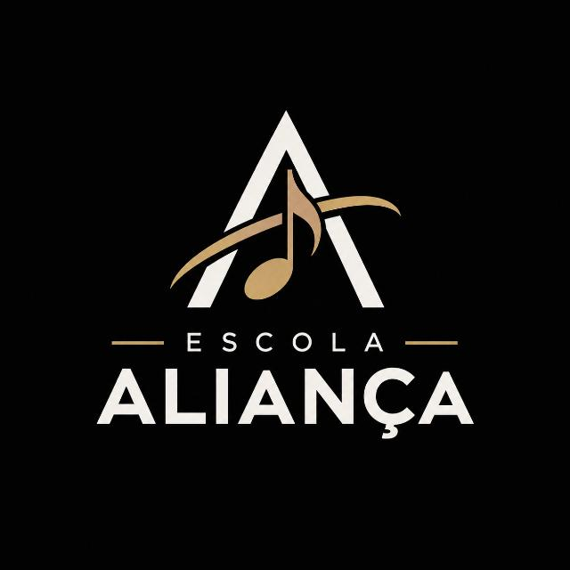

# Escola Aliança

O aplicativo da equipe da escola de música da Igreja Batista Horizonte. Professores e administradores usam o sistema para organizar a escala, registrar aulas e acompanhar os alunos.

**[Abrir o site](https://escola-ibh.vercel.app)** · **[Baixar o APK para Android](https://github.com/Liezy/EscolaIBH/releases)**

## O que você pode fazer

- Consultar e organizar a escala de encontros.
- Registrar o que foi trabalhado em aula e consultar o histórico.
- Cadastrar alunos e acompanhar suas modalidades.

## Como acessar

Entre com o e-mail e a senha fornecidos pela administração da escola. As mesmas credenciais funcionam no site e no aplicativo.

Para instalar no Android, abra a [página de versões](https://github.com/Liezy/EscolaIBH/releases), baixe o arquivo `.apk` na seção **Assets** e abra-o no celular. O aplicativo precisa de internet e é compatível com Android 7 ou superior.

Para manter ou compilar o projeto, consulte o [guia de desenvolvimento e implantação](docs/desenvolvimento.md).
